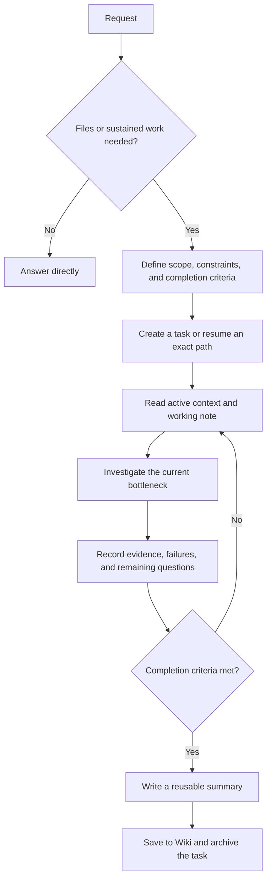

# Research Attention Starter

A lightweight, local-first workflow for AI-assisted research, with explicit evidence boundaries and human control over consequential decisions.

Keep one focused task, preserve useful failures, and turn results into reusable knowledge. Plain Markdown files hold the working state; a small Python script handles the file lifecycle. No API keys, third-party Python packages, or specific AI provider are required.

## Quick start

Requires Python 3.10 or newer. On Windows, use `py -3` if `python3` is unavailable.

```bash
git clone https://github.com/GuoChencheng/research-attention-starter.git
cd research-attention-starter
python3 starter.py self-test
python3 starter.py init ../my-research
cd ../my-research
python3 starter.py new first-question --objective "Determine whether my claim holds under explicit assumptions"
```

The last command prints the exact task directory. Fill in `CONTEXT.md` and that task's `BRIEF.md`. Copy the prompt in [START_HERE.md](START_HERE.md) into your assistant and replace its task-path placeholder with the printed path. If your assistant cannot read local files, paste the relevant files manually. Automatic discovery of `AGENTS.md` depends on the assistant.

You can also download a release ZIP, extract it, and run the same commands starting with `self-test` inside its directory.

## Workflow



Consult [WORKFLOW.md](WORKFLOW.md) for human decision boundaries, evidence labels, and exact artifact preservation.

## Daily use

Edit `BRIEF.md` and `WORKING_NOTE.md`, then refresh the generated view:

```bash
python3 starter.py refresh test/YYYY-MM-DD_first-question
```

Replace the example path with the actual task path. To resume, give your assistant that exact directory; do not create another task for the same episode.

When the requested investigation is complete, write a summary containing the outcome, evidence scope, useful failures, and unresolved questions:

```bash
python3 starter.py close test/YYYY-MM-DD_first-question --summary summary.md
```

This writes `wiki/YYYY-MM-DD_first-question.md` and moves the task into `History/`. The command checks paths and collisions; **it does not decide whether the research is complete or scientifically correct**.

## Generated workspace

```text
my-research/
├── AGENTS.md
├── CONTEXT.md
├── START_HERE.md
├── WORKFLOW.md
├── starter.py
├── templates/
├── test/
│   └── YYYY-MM-DD_first-question/
│       ├── BRIEF.md
│       ├── WORKING_NOTE.md
│       └── ACTIVE_CONTEXT.md
├── wiki/
└── History/
```

Git is optional in generated workspaces. Initialize it yourself if desired and review selected files before committing. Workspaces may contain unpublished research; their publication is a separate decision.

## Example and limits

[The worked example](examples/finite-check.md) shows how finite observations, a counterexample, and a proof have different roles.

Implemented: initialization, task creation, active-context refresh, summary archival, overwrite refusal, and a temporary-workspace self-test. Dates in task names use your computer's local date. Files use UTF-8.

This starter does not implement an autonomous agent, model dispatch, scientific certification, automatic Wiki retrieval, or the full parent system's Git/Wiki checkpoint machinery. Human decision rules in `AGENTS.md` are instructions to an assistant, not a technical permissions sandbox. Use one writer per workspace; concurrent updates and crash-transaction recovery are outside this release's scope.

CI runs the self-test on Linux, macOS, and Windows with Python 3.10 and 3.14. Check the [Actions results](https://github.com/GuoChencheng/research-attention-starter/actions) for current outcomes.

## Origin and license

Adapted from a minimal Research Attention OS pack prepared in September 2026. The public edition contains generic workflow instructions, templates, an educational example, and standalone code. Parent-system archival commands are not required.

MIT licensed. See [LICENSE](LICENSE). Issues and focused pull requests are welcome; include a reproduction and avoid private research material.
